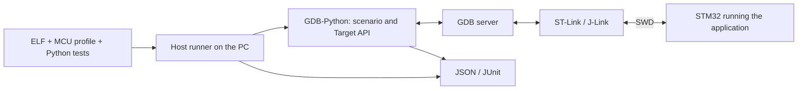

# stm32-gdbtest

[](https://github.com/ViacheslavMezentsev/stm32-gdbtest/actions/workflows/docs.yml)
[](https://github.com/ViacheslavMezentsev/stm32-gdbtest/actions/workflows/offline.yml)
[](https://github.com/ViacheslavMezentsev/stm32-gdbtest/releases)

[Русский](README.md)

**stm32-gdbtest implements [DDTT](docs/en/DDTT.md) for STM32: scenarios kept in the project repository
check the running firmware on a real board through GDB and an SWD debugger.** There is no test code in the
firmware; one scenario runs by hand, from CTest, in CI or in a loop on a stand. The module is the main tool
of the TTDD methodology ([skills and routes](skills/README.en.md)).

## How it works



An ordinary `def` runs operations in order: each one completes before the next line. Use `async def` when
the target must run without stopping: `resume(sync=False)` lets it go, `await wait/halt` wait with a timeout,
and navigation and calls in such a scenario are written with `await`.

```python
from stm32_gdbtest import case, one_of


@case("HW_APP_STEP")                                        # scenario ID, linked to a requirement
def app_step(t):                                            # def: operations run in order
    t.reach("app_loop")                                     # run to the function and stop
    before = t.read("app_state.ticks")                      # read a firmware variable
    t.reach("app_step")                                     # stop at the entry of an application step
    t.finish()                                              # run the step until it returns
    after = t.read("app_state.ticks")                       # read the variable again
    t.check("one step", (after - before) & 0xFFFFFFFF, 1)   # compare with the expectation
    t.check("LED", t.mmio.read("GPIOC.ODR") >> 13 & 1, one_of(0, 1))  # register by its SVD name
    result = t.call("app_checksum", 7, timeout=2)           # call a firmware function with a time limit
    t.record("app.step", {"ticks": after, "sum": result["return_value"]})  # keep the data in the report


@case("HW_APP_LIVE")                                        # a second scenario of the same project
async def app_live(t):                                      # async def: navigation and calls use await
    await t.reach("app_loop")                               # run to the application loop
    t.resume(sync=False)                                    # let the target go and return at once
    try:                                                    # the target runs: stop it whatever happens
        with t.refused("not_stopped"):                      # memory access to a running target is refused
            t.read("app_state.ticks")                       # this operation never reaches the target
        waited = await t.wait(timeout=0.2)                  # wait for a stop for at most 0.2 s
        t.check("still running", waited["outcome"], "timeout")  # the target did not stop by itself
    finally:                                                # runs after an error too
        stopped = await t.halt(timeout=2)                   # stop the target and confirm it
    t.check("halted", stopped["outcome"], "stopped")        # the core is halted, memory is readable again
```

The firmware symbols in the example are illustrative. `t.mmio` needs an SVD in `session.toml` (`[mmio] svd`).
Proven techniques are in the [technique catalogue](docs/en/TESTING_TECHNIQUES.md), methods in the
[API reference](docs/en/api/index.md).

## Quick start

The module is added as a Git submodule; the MCU profile, scenarios and stand stay in the project.
[Integration and first run](docs/en/GETTING_STARTED.md):

```sh
git submodule add https://github.com/ViacheslavMezentsev/stm32-gdbtest modules/stm32-gdbtest
cmake --preset <profile>-hil && cmake --build --preset <profile>-hil
ctest --preset <profile>-hil-host     # no board: ELF contracts, prepare, requirement traceability
ctest --preset <profile>-hil-hw       # on the board; the stand is set in hil/<MCU>/stands/local.toml
```

## Features

- OpenOCD, ST-LINK GDB Server, st-util, J-Link; the GDB server next to the PC or on a Linux stand over SSH.
- Synchronous and async API 3 scenarios: navigation, data, `ret`/`call` injection, check tables, `record`.
- Peripheral registers by SVD with access-right and effect checks (`t.mmio`).
- Offline checks (`inspect`, `prepare`, ELF contracts), prepared run packages and stand loops.
- Renode and QEMU emulators for experiments without a board; JSON/JUnit reports, DDTT export to HTML/LCOV/Cobertura.

## Limitations

- GDB knowledge is required: the author chooses stop points, expectations and allowed interventions.
- Stops and injections change timing and interrupts; peripherals may keep running.
- A result applies to the combination of MCU, build, GDB and server; see the [current status](docs/en/STATUS.md).
- Recovery after a lost USB/SWD link is an attempt, not a guarantee.
- The module does not replace measuring instruments and does not compute coverage automatically.

## Documentation

[Documentation map](docs/en/index.md) · [API reference](docs/en/api/index.md) · [DDTT](docs/en/DDTT.md) ·
[skills and TTDD](skills/README.en.md) · [site: routes and API](https://viacheslavmezentsev.github.io/stm32-gdbtest/index.en.html) ·
[stands](docs/en/STANDS.md) · [current status](docs/en/STATUS.md) · [versions](docs/en/VERSIONING.md) ·
[changes](CHANGELOG.en.md) · [specification (Russian)](docs/TECHNICAL_SPECIFICATION.md)

Licence: [MIT](LICENSE). Rules for contributors and agents: [AGENTS.md](AGENTS.md).
