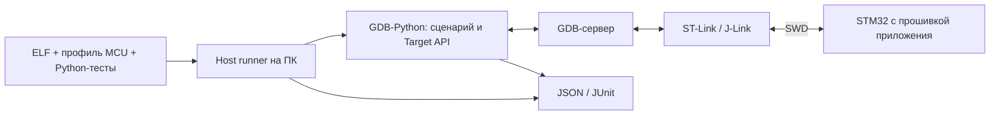

# stm32-gdbtest

[](https://github.com/ViacheslavMezentsev/stm32-gdbtest/actions/workflows/docs.yml)
[](https://github.com/ViacheslavMezentsev/stm32-gdbtest/actions/workflows/offline.yml)
[](https://github.com/ViacheslavMezentsev/stm32-gdbtest/releases)

[English](README.en.md)

**stm32-gdbtest — реализация [DDTT](docs/ru/DDTT.md) для STM32: сценарии в репозитории проекта
проверяют работающую прошивку на реальной плате через GDB и SWD-отладчик.** Тестового кода в прошивке
нет; один сценарий запускается вручную, из CTest, в CI или в цикле на стенде. Модуль — главный инструмент
методологии TTDD ([навыки и маршруты](skills/README.md)).

## Как это работает



Обычный `def` выполняет операции по очереди: каждая завершается до следующей строки. `async def` нужен,
когда цель должна поработать без остановки: `resume(sync=False)` отпускает её, `await wait/halt` ждут
с таймаутом, а навигация и вызовы в таком сценарии пишутся с `await`.

```python
from stm32_gdbtest import case, one_of


@case("HW_APP_STEP")                                        # ID сценария, связан с требованием
def app_step(t):                                            # def: операции выполняются по очереди
    t.reach("app_loop")                                     # дойти до функции и остановиться
    before = t.read("app_state.ticks")                      # прочитать переменную прошивки
    t.reach("app_step")                                     # остановиться на входе в шаг приложения
    t.finish()                                              # выполнить шаг до возврата
    after = t.read("app_state.ticks")                       # прочитать переменную снова
    t.check("one step", (after - before) & 0xFFFFFFFF, 1)   # сравнить с ожиданием
    t.check("LED", t.mmio.read("GPIOC.ODR") >> 13 & 1, one_of(0, 1))  # регистр по имени из SVD
    result = t.call("app_checksum", 7, timeout=2)           # вызвать функцию прошивки с лимитом времени
    t.record("app.step", {"ticks": after, "sum": result["return_value"]})  # сохранить данные в отчёт


@case("HW_APP_LIVE")                                        # второй сценарий того же проекта
async def app_live(t):                                      # async def: навигация и вызовы — с await
    await t.reach("app_loop")                               # дойти до цикла приложения
    t.resume(sync=False)                                    # отпустить цель и сразу вернуть управление
    try:                                                    # цель работает: остановить её при любом исходе
        with t.refused("not_stopped"):                      # доступ к памяти работающей цели отклоняется
            t.read("app_state.ticks")                       # эта операция не дойдёт до цели
        waited = await t.wait(timeout=0.2)                  # ждать остановки не дольше 0,2 с
        t.check("still running", waited["outcome"], "timeout")  # цель не остановилась сама
    finally:                                                # выполняется и после ошибки
        stopped = await t.halt(timeout=2)                   # остановить цель с подтверждением
    t.check("halted", stopped["outcome"], "stopped")        # ядро стоит, память снова доступна
```

Символы прошивки в примере условные. Для `t.mmio` в `session.toml` указывается SVD (`[mmio] svd`).
Проверенные приёмы — в [каталоге техник](docs/ru/TESTING_TECHNIQUES.md), методы — в [справочнике API](docs/ru/api/index.md).

## Быстрый старт

Модуль подключается Git-подмодулем; профиль MCU, сценарии и стенд остаются в проекте.
[Подключение и первый прогон](docs/ru/GETTING_STARTED.md):

```sh
git submodule add https://github.com/ViacheslavMezentsev/stm32-gdbtest modules/stm32-gdbtest
cmake --preset <profile>-hil && cmake --build --preset <profile>-hil
ctest --preset <profile>-hil-host     # без платы: контракты ELF, prepare, трассировка требований
ctest --preset <profile>-hil-hw       # на плате, стенд задаётся в hil/<MCU>/stands/local.toml
```

## Возможности

- OpenOCD, ST-LINK GDB Server, st-util, J-Link; GDB-сервер рядом с ПК или на Linux-стенде по SSH.
- Синхронные и async-сценарии API 3: навигация, данные, инъекции `ret`/`call`, таблицы проверок, `record`.
- Регистры периферии по SVD с проверкой прав и эффектов (`t.mmio`).
- Офлайн-проверки (`inspect`, `prepare`, контракты ELF), пакеты подготовленного запуска и стендовые циклы.
- Эмуляторы Renode и QEMU для опытов без платы; отчёты JSON/JUnit, DDTT-экспорт HTML/LCOV/Cobertura.
- С 0.6.0: квоты и строгая полнота [журнала](docs/ru/JOURNALING.md), вызовы C++ и [пошаговая отладка сценария в VS Code](docs/ru/MANUAL_DEBUG.md).

## Ограничения

- Нужно понимать GDB: автор выбирает точки остановки, ожидания и допустимые воздействия.
- Остановки и инъекции меняют время и прерывания; периферия может работать дальше.
- Результат относится к сочетанию MCU, сборки, GDB и сервера; [текущее состояние](docs/ru/STATUS.md).
- Восстановление после потери USB/SWD — попытка, а не гарантия.
- Модуль не заменяет измерительные приборы и не вычисляет покрытие автоматически.

## Документация

[Карта документации](docs/ru/index.md) · [справочник API](docs/ru/api/index.md) · [DDTT](docs/ru/DDTT.md) ·
[навыки и TTDD](skills/README.md) · [сайт: маршруты и API](https://viacheslavmezentsev.github.io/stm32-gdbtest/) ·
[стенды](docs/ru/STANDS.md) · [текущее состояние](docs/ru/STATUS.md) · [версии](docs/ru/VERSIONING.md) ·
[изменения](CHANGELOG.md) · [ТЗ](docs/TECHNICAL_SPECIFICATION.md)

Лицензия — [MIT](LICENSE). Правила для участников и агентов — [AGENTS.md](AGENTS.md).
