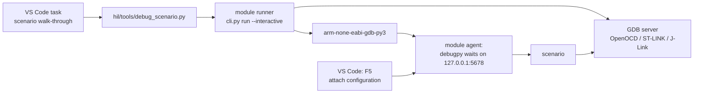

# Stepping through a scenario in VS Code

[Documentation](index.md) → Stepping through a scenario · [Русский](../ru/MANUAL_DEBUG.md)

A scenario is easier to write and investigate step by step: where it halted the core, what
`t.read` returned, why a check failed. The interactive run `run --interactive` serves this:
the Python inside GDB waits for the VS Code debugger (debugpy), and breakpoints, stepping,
Variables, Watch and the Debug Console work in the scenario file. Every access to the MCU goes
through the same Target API as in an automated run.

**Only the run** selects the mode. The scenario, its `@case(..., timeout_s=...)` and the CTest
registration do not change, so a debugged scenario runs in CTest and CI without edits.
Ready projects are [stm32-hwtest-bluepill](https://github.com/ViacheslavMezentsev/stm32-hwtest-bluepill)
and [stm32-hwtest-blackpill](https://github.com/ViacheslavMezentsev/stm32-hwtest-blackpill):
VS Code tasks, the debugger configuration and the launcher `hil/tools/debug_scenario.py`.

> An interactive walk-through is diagnostics, not acceptance. Its results go to
> `build/<preset>/hwtest/interactive-runs` with `execution_kind: "interactive"`, separate from
> `hwtest/runs`, and are not included in `results.py`, CTest, DDTT or reports. Expressions
> evaluated in the Debug Console access the board and become part of the experiment.

## How it works



1. Before taking the stand the runner checks that the port is free and debugpy is found.
   debugpy comes from the VS Code extension `ms-python.debugpy`; use `--debugpy` or the
   `STM32_GDBTEST_DEBUGPY` variable for another directory. Nothing is downloaded.
2. The agent in GDB opens debugpy on `127.0.0.1:<port>` **before the first MCU access**; the
   runner prints `Interactive: attach the debugger to 127.0.0.1:5678`.
3. After F5 the agent connects to the board, verifies the image and runs the scenario;
   breakpoints hit in its lines.
4. There is no overall time limit: you may stay at a breakpoint as long as needed. For async
   scenarios the `timeout_s` deadline does not apply either. Ctrl+C in the terminal cancels the
   run: the result is ERROR, GDB stops and the board is restored.

## How it differs from an automated run

| | Automated (CTest, CI, "one test") | Interactive (`--interactive`) |
| :--- | :--- | :--- |
| Who selects it | — | only the run: CLI or a VS Code task |
| Limit of the whole run | the scenario's `timeout_s` or `--timeout`, up to 300 s | none; Ctrl+C cancels |
| Async scenario deadline | `timeout_s − 2` s | none |
| Operation limits (`t.call`, `wait`, `reach` with `timeout`), server startup, recovery | yes | the same |
| Waiting for a debugger | no | before the first MCU access |
| Results directory | `hwtest/runs` | `hwtest/interactive-runs` |
| `execution_kind` in `result.json` | no field | `"interactive"` |
| `results.py` summary, CTest JUnit, DDTT, reports | included | not included |

## Requirements

- stm32-gdbtest with `run --interactive` (0.6.0 and later). With module 0.5.x
  the launcher works in a simplified mode — see [below](#module-05x).
- VS Code with the extensions from the project's `.vscode/extensions.json`: Python
  (`ms-python.python`, which brings Pylance) and Python Debugger (`ms-python.debugpy`).
- GDB with Python (`arm-none-eabi-gdb-py3`); the path comes from the build, as in a regular run.
- A built HIL preset (`f103c8-hil`, `f411ce-hil` …) and the board's stand file
  ([Stands](STANDS.md), `hil/<board>/stands/local.toml`).
- The board is connected and nothing else uses its debugger now (CTest, Cortex-Debug).

## Preparing VS Code

The settings are already in `.vscode/settings.json` of both projects; copy them to your own project.

| Annoyance | Cause | Setting |
| :--- | :--- | :--- |
| `from stm32_gdbtest import case` is underlined, no completion | the module lives in the submodule, not in an installed Python | `"python.analysis.extraPaths": ["${workspaceFolder}/modules/stm32-gdbtest"]` |
| yellow line under `import gdb` | the `gdb` module exists only inside GDB; Pylance takes its types from bundled stubs and finds no source | `"python.analysis.diagnosticSeverityOverrides": { "reportMissingModuleSource": "none" }` |
| cSpell underlines `RCC_APB2ENR`, `HW_BOOT` | register and scenario names are not dictionary words | `"cSpell.ignoreRegExpList": ["\\b[0-9A-Z_]+\\b"]` |
| CMake Tools looks for `cl.exe` and activates the Visual Studio environment | without the setting CMake Tools brings in MSVC even for an ARM build | `"cmake.useVsDeveloperEnvironment": "never"` |

The selected Python interpreter (Python: Select Interpreter) must be ≥ 3.11: it runs the
launcher and the runner; the Python inside GDB is separate and is not selected here. After
changing settings run Developer: Reload Window.

The debugger configuration in `.vscode/launch.json`:

```json
{
  "name": "Сценарий: подключиться (debugpy)",
  "type": "debugpy",
  "request": "attach",
  "connect": { "host": "127.0.0.1", "port": 5678 },
  "justMyCode": true
}
```

## Step by step: BluePill, F103C8

The example is `HW_SYSTICK_PROGRESS` from `hil/common/tests/board/test_startup.py`: two
neighbouring entries into `SysTick_Handler`, the `g_ticks` counter grows by exactly 1 between them.

1. **Build.** Tasks: Run Task → "HIL: F103C8 — собрать".
2. **Breakpoints.** Open `hil/common/tests/board/test_startup.py` and set a breakpoint on
   `t.check("SysTick exception context", …)` and on
   `t.record("startup.systick", …)`.
3. **Start.** Tasks: Run Task → "HIL: F103C8 — пошаговый проход сценария (VS Code)…" → pick
   `HW_SYSTICK_PROGRESS`. The terminal shows:
   ```text
   Interactive run HW_SYSTICK_PROGRESS: results in …\hwtest\interactive-runs\…
   Interactive: attach the debugger to 127.0.0.1:5678 (no time limit; Ctrl+C cancels the run)
   ```
4. **Attach.** Run and Debug → "Сценарий: подключиться (debugpy)" → F5. Within 1–3 s execution
   stops at the first breakpoint: the core is already halted in `SysTick_Handler`.
5. **Inspect.** Variables shows the scenario locals (`t`, `before`). In the Debug Console:
   ```python
   before                        # value read by the scenario
   t.read("g_ticks")             # the same field now
   t.mmio.read("SCB.ICSR") & 0x1FF  # active exception: 15 is SysTick
   hex(t.read("$pc"))
   t.mmio.read("SysTick.LOAD")   # register through SVD
   t.frames(3)                   # firmware stack
   ```
   Each expression accesses the board through GDB, exactly like the scenario itself.
6. **Steps.** F10 goes to the next scenario line, F5 to the next breakpoint. At the second
   breakpoint `(after - before) & 0xFFFFFFFF` gives 1. With `"justMyCode": true` stepping does
   not enter the module; set it to `false` to walk through the Target API as well.
7. **Result.** After F5 the scenario runs to the end; the terminal shows
   `PASS HW_SYSTICK_PROGRESS` and the `result.json` path. List the interactive runs:
   ```powershell
   python hil/tools/results.py --runs build/f103c8-hil/hwtest/interactive-runs
   ```
8. **Automated run.** When the scenario is ready, run it as usual — with the "one test" task or
   `ctest --preset f103c8-hil-hw`. Only that result is evidence.

## BlackPill and other boards

| Project | Board | Task | Example |
| :--- | :--- | :--- | :--- |
| stm32-hwtest-bluepill | F103C8, F103CB | "HIL: F103C8 — пошаговый проход сценария (VS Code)…" | `HW_SYSTICK_PROGRESS` |
| stm32-hwtest-blackpill | F411CE, F401CC | "HIL: F411CE — пошаговый проход сценария (VS Code)…" | `HW_BOOT` |

For BlackPill: a breakpoint on `t.check([` in `boot()` of `hil/common/tests/board/test_boot.py`;
in the Debug Console `t.read("SystemCoreClock")`, `hex(t.mmio.read("RCC.CFGR"))`,
`t.frames(2)["frames"][0]["name"]`.

## From a terminal

Through the project launcher:

```powershell
python -B hil/tools/debug_scenario.py --build build/f103c8-hil --test HW_SYSTICK_PROGRESS `
    --stand hil/F103C8/stands/local.toml
```

Or directly through the module:

```powershell
python -B modules/stm32-gdbtest/stm32_gdbtest/cli.py run --session build/f103c8-hil/hwtest/session.json `
    --test HW_SYSTICK_PROGRESS --stand hil/F103C8/stands/local.toml --identity-policy strict --interactive
```

Then in VS Code: F5 "Сценарий: подключиться (debugpy)".

| `run` option | Meaning |
| :--- | :--- |
| `--interactive` | interactive run |
| `--debug-port` | debugpy port on 127.0.0.1, 5678 by default; for another one change `connect.port` in launch.json |
| `--debugpy` | directory with the debugpy package if the VS Code extension is not found |

`--timeout` and `--prepare-only` cannot be combined with `--interactive`: an interactive run has
no limit and needs a board.

To add the mode to your own project, copy `hil/tools/debug_scenario.py`, the task and the
`debugpy` attach configuration from `.vscode` of either project, or call `cli.py run
--interactive` from your own task; the readiness line for a background task is
`Interactive: attach the debugger`.

## Keeping automated runs intact

- Do not change `timeout_s` for pauses: it describes the scenario in an automated run; the
  interactive run does not use it.
- Do not leave `breakpoint()`, `import debugpy` and the like in a scenario: breakpoints are set
  in the editor, the run selects the mode.
- What you do by hand in the Debug Console (`t.write`, `t.call`, `t.mmio.read(...,
  allow_effects=True)`) is not part of the scenario. Move a needed step into the code and check
  it with an automated run.
- An interactive PASS does not replace an automated one: after debugging run the scenario with
  the "one test" task or through CTest.

## Limits

- **One session.** Do not run CTest, Cortex-Debug or a second walk-through on the same debugger
  at the same time; port 5678 must be free. The stand stays busy for the whole walk-through,
  including while debugpy waits for the attach.
- **Cancelling.** Ctrl+C in the task terminal (on Windows also Ctrl+Break). The Stop button in
  VS Code only detaches the debugger: the scenario then runs to the end without stops.
- **Breakpoints** work in files executed by the agent: the scenario file and modules it imports.
  Firmware lines are not available here: this is Python debugging, not C.
- **Not checked:** remote stands over SSH, Linux, J-Link and ST-LINK GDB Server. Checked: local
  OpenOCD (ST-Link) stands on Windows.

## Module 0.5.x

While a project is pinned to a module without `run --interactive`, the `debug_scenario.py`
launcher attaches debugpy itself: through a separate Python user directory of this build
(`PYTHONUSERBASE`) that the runner passes to GDB. Limits of this mode:

- the whole run is limited by the launcher's `--timeout`, up to 300 s; when it is exceeded the
  runner terminates GDB with ERROR, board recovery may not fit into its own limit and the core
  stays halted — run any scenario with the "one test" task;
- async scenarios keep their `timeout_s` deadline;
- results go to `hwtest/manual-runs` without the `execution_kind` field.

Once the project moves to a module with `run --interactive`, the launcher selects the
interactive mode itself.

## What was checked

28.10.2026, Windows, Python 3.12.8 inside `arm-none-eabi-gdb-py3` (xPack 14.2.1), debugpy from
`ms-python.debugpy` 2026.6.0, local OpenOCD 0.12.0. The hardware experiments were driven by a
programmatic DAP client (attach, breakpoints, `stackTrace`, `evaluate`, `next`, `continue`); a
walk-through in VS Code itself was confirmed separately.

| Experiment | Result |
| :--- | :--- |
| Host: result isolation, no overall limit, refusals before the stand (port, debugpy, `--timeout`, `--prepare-only`), debugpy discovery, CLI | 6/6 |
| BlackPill F411CE, `HW_BOOT`, 320 s at a breakpoint (longer than any runner limit) | PASS in `interactive-runs`, 323.5 s |
| F411CE, async scenario with `timeout_s=5`, 30 s pause between two `await t.reach(...)` | PASS |
| F411CE, cancelling with Ctrl+Break at a breakpoint | ERROR, `teardown=reset_run`, the board runs |
| F411CE, the same scenarios automated | PASS in `runs`, no `execution_kind` |
| BluePill F103C8, `HW_SYSTICK_PROGRESS`: two breakpoints, `t.read`, step, 15 s pause | PASS |
| F411CE, module 0.5.0 (simplified launcher mode) | PASS in `manual-runs` |
| VS Code: BlackPill F411CE, `HW_BOOT` — task, F5, stop at a breakpoint, Variables, call stack, Debug Console | works |

On every board a Flash copy was taken before the experiment and written back afterwards with a
SHA-256 check.
