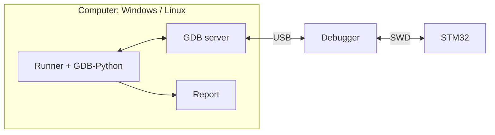
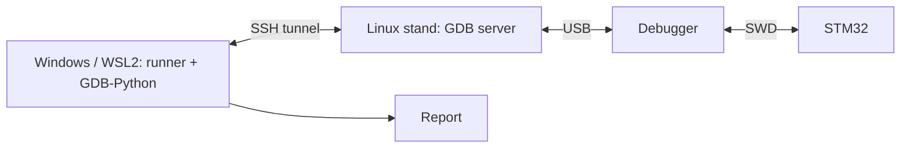
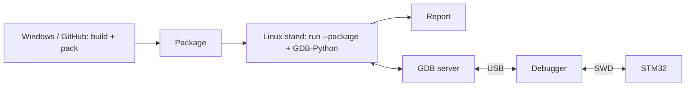
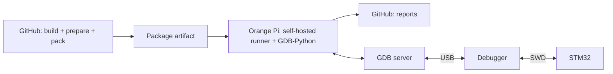
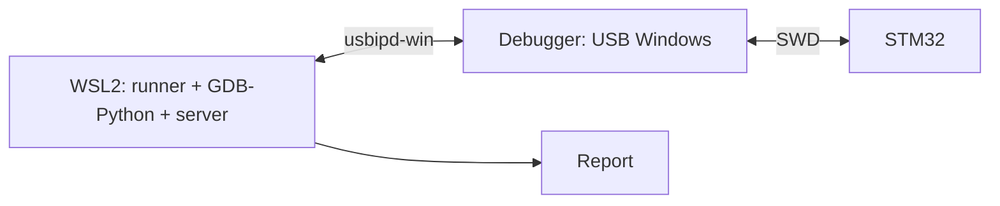

# Run layouts

[Documentation](index.md) → Run layouts · [Русский](../ru/RUN_LAYOUTS.md)

The scenario and the report are the same in every layout; only the local stand file
(`*.local.toml`, `remote.toml`) changes, and it stays with the user.

| Layout | Runner/GDB location | Connection |
| --- | --- | --- |
| Local | Windows or Linux | Local GDB server and USB/SWD |
| Remote server | Windows/Linux, including WSL2 | SSH to the stand host |
| Package | Execution host | Prepared inputs, local or SSH server |
| Hardware CI | Self-hosted stand host | Hardware job separate from build |
| Emulator | Windows/Linux | Owned Renode or QEMU, no board |

Verified scope per route: [0.5.0 matrix](../development/release-050-acceptance.md).
A diagram does not establish hardware acceptance for every OS/backend/MCU.
[Renode](RENODE.md), [QEMU](QEMU.md).

### Local run: Windows or Linux

Runner, GDB-Python and server share one computer. This covers Windows
and Orange Pi; local Linux x86_64 has not yet been verified on hardware.

### Remote server: Windows or WSL2 → Linux stand

Runner and scenario stay on the workstation. SSH starts the server on the stand
and tunnels the GDB connection. The debugger is physically attached to the stand.

### Package: build separately from execution

A package containing ELF, profile and scenarios is transferred to the stand.
`run --package` runs both GDB-Python and the server there; reports stay there too.

### Hardware CI: GitHub and a self-hosted runner

A GitHub-hosted job builds and prepares the package without a board. A self-hosted
job on Orange Pi downloads it, runs hardware checks and uploads reports.

### WSL2 USB forwarding: not hardware-verified

All test processes run in WSL2; Windows forwards the USB device into Linux
through usbipd-win. This distinct layout has not yet been verified on boards.

Remote mode uses SSH keys only; the debugger lock is held on the stand host and the
link is watched by a heartbeat. ST-LINK GDB Server is not available on Linux aarch64
(ST does not ship it for arm64), so OpenOCD, J-Link and st-util are used on Orange Pi.
Details: [Linux stand](LINUX_STAND.md), [GDB servers](BACKENDS.md).

[Reading metrics](HARDWARE_METRICS.md).
