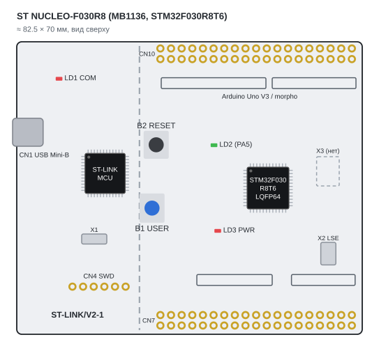
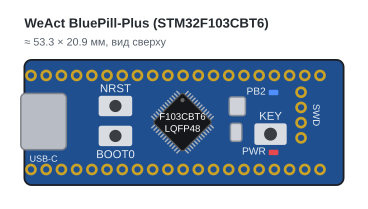
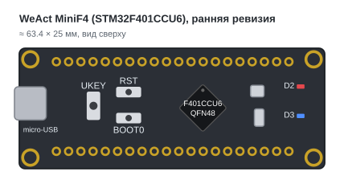
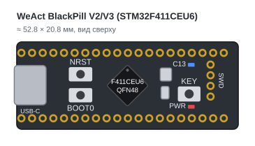
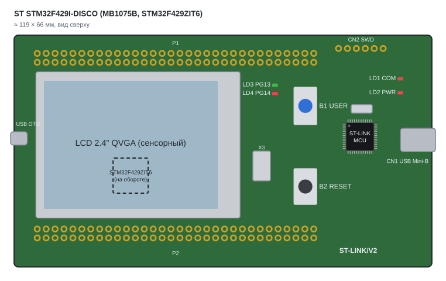
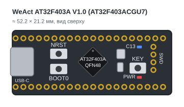

# Stands

[Documentation](index.md) → Stands · [Русский](../ru/STANDS.md)

Boards on which the module is verified: the CI firmware in `tests/firmware/profiles/`, the F030 HAL fixture,
the live-observer example and the demo consumers
[stm32-hwtest-bluepill](https://github.com/ViacheslavMezentsev/stm32-hwtest-bluepill) and
[stm32-hwtest-blackpill](https://github.com/ViacheslavMezentsev/stm32-hwtest-blackpill).
MCU profiles are described in [MCU profiles](MCU_PROFILES.md), debug servers in [GDB servers](BACKENDS.md),
process placement in [run layouts](RUN_LAYOUTS.md), results in [acceptance](../evidence/en/API_ACCEPTANCE.md).

The drawings are schematic top views at one scale (1 mm = 6 pixels), oriented as in the stand photos.
They show only what matters for a stand: MCU, connectors, buttons, LEDs, crystals, pin headers and SWD.
Positions are approximate (about 0.5 mm); `docs/images/stands/make_stands.py` generates them.

## Summary

| Board | MCU | Core, clock | Flash / SRAM | HSE / LSE crystals | LED / button | Debugger on the stand |
| --- | --- | --- | --- | --- | --- | --- |
| ST NUCLEO-F030R8 (MB1136 rev C) | STM32F030R8T6, LQFP64 | Cortex-M0, 48 MHz | 64 / 8 KiB | 8 MHz from the ST-LINK MCO / 32.768 kHz (X2) | LD2 PA5, active high / B1 PC13 | onboard ST-LINK/V2-1 |
| WeAct BluePill-Plus | STM32F103CBT6, LQFP48 | Cortex-M3, 72 MHz | 128 / 20 KiB | 8 MHz / 32.768 kHz | PB2, active high / KEY PA0 | external ST-Link or J-Link over SWD |
| WeAct MiniF4, early revision | STM32F401CCU6, QFN48 | Cortex-M4F, 84 MHz | 256 / 64 KiB | 25 MHz / 32.768 kHz | PC13 / UKEY PA0 | external ST-Link over SWD |
| WeAct BlackPill V2/V3 | STM32F411CEU6, QFN48 | Cortex-M4F, 100 MHz | 512 / 128 KiB | 25 MHz / 32.768 kHz | C13, active low / KEY PA0 | external ST-Link over SWD |
| ST STM32F429I-DISCO (MB1075B) | STM32F429ZIT6, LQFP144 | Cortex-M4F, 180 MHz | 2048 / 256 KiB | 8 MHz from the ST-LINK MCO / not fitted | LD3 PG13, LD4 PG14 / B1 PA0 | onboard ST-LINK/V2 |
| WeAct AT32F403A V1.0 | Artery AT32F403ACGU7, QFN48 | Cortex-M4F, 240 MHz | 1024 / 96 KiB¹ | see the WeAct schematic | C13, active low / KEY | J-Link (WinUSB) over SWD |

¹ Flash follows the `tests/firmware/profiles/at32f403a` profile; SRAM follows the WeAct description (96 KiB, plus
128 KiB in the chip's extended mode, which the module does not use).

One BluePill-Plus board with an STM32F103CBT6 serves both stm32-hwtest-bluepill profiles (F103C8 and F103CB);
the module's `f103c8` CI profile runs on it too. The MiniF4 revision with the F401CC differs from BlackPill V2/V3:
micro-USB, a UKEY button, D2/D3 LEDs and four mounting holes.

Hosts: Windows (runner, GDB, OpenOCD, ST-LINK GDB Server, J-Link) and an Orange Pi 5 Linux stand
(Ubuntu 20.04) for layouts with the GDB server over SSH ([Linux stand](LINUX_STAND.md)).

## Boards

### NUCLEO-F030R8

Onboard ST-LINK/V2-1 (left, snap-off part) with USB Mini-B; morpho CN7/CN10 headers and Arduino Uno V3
connectors. Used by the `f030r8` CI firmware and the `tests/hal-f030` HAL fixture.
Source: [UM1724](https://www.st.com/resource/en/user_manual/dm00105823.pdf).

### WeAct BluePill-Plus (STM32F103CBT6)

USB-C, NRST and BOOT0 on the left, KEY on the right, 4-pin SWD at the end. Source:
[WeActStudio/BluePill-Plus](https://github.com/WeActStudio/BluePill-Plus).

### WeAct MiniF4 (STM32F401CCU6), early revision

micro-USB, UKEY, RST and BOOT0 buttons, D2 and D3 LEDs. Source:
[WeActStudio.MiniSTM32F4x1](https://github.com/WeActStudio/WeActStudio.MiniSTM32F4x1).

### WeAct BlackPill V2/V3 (STM32F411CEU6)

USB-C, NRST, BOOT0 and KEY buttons, C13 and PWR LEDs, 4-pin SWD. Used by the `f411ce` CI firmware, the
live-observer example (VTOR/FPB) and the stm32-hwtest-blackpill consumer. Sources:
[WeActStudio.MiniSTM32F4x1](https://github.com/WeActStudio/WeActStudio.MiniSTM32F4x1),
[stm32-base](https://stm32-base.org/boards/STM32F411CEU6-WeAct-Black-Pill-V2.0).

### STM32F429I-DISCO

The 2.4″ LCD covers most of the board; the STM32F429ZIT6 is not visible from the top (drawn dashed).
Onboard ST-LINK/V2 (right, USB Mini-B), P1/P2 headers. Source:
[UM1670](https://www.st.com/resource/en/user_manual/dm00093903.pdf).

### WeAct AT32F403A V1.0

Same footprint and layout as the BlackPill: USB-C, NRST, BOOT0, KEY, C13, PWR, SWD. Connecting a compatible
MCU: [compatible MCUs](COMPATIBLE_MCU.md). Source:
[WeActStudio.BlackPill](https://github.com/WeActStudio/WeActStudio.BlackPill).
