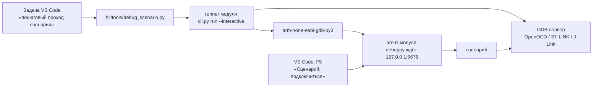

# Пошаговый проход сценария в VS Code

[Документация](index.md) → Пошаговый проход сценария · [English](../en/MANUAL_DEBUG.md)

Сценарий удобно писать и разбирать по шагам: где он остановил ядро, что вернул `t.read`,
почему не сошлась проверка. Для этого есть интерактивный запуск `run --interactive`:
Python внутри GDB ждёт отладчик VS Code (debugpy), и в файле сценария работают точки
останова, шаги, Variables, Watch и Debug Console. Все обращения к MCU идут через тот же
Target API, что и в автоматическом прогоне.

Режим выбирает **только запуск**. Сценарий, его `@case(..., timeout_s=...)` и регистрация
CTest не меняются, поэтому отлаженный сценарий без правок выполняется в CTest и CI.
Готовые проекты — [stm32-hwtest-bluepill](https://github.com/ViacheslavMezentsev/stm32-hwtest-bluepill)
и [stm32-hwtest-blackpill](https://github.com/ViacheslavMezentsev/stm32-hwtest-blackpill):
задачи VS Code, конфигурация отладчика и запускатель `hil/tools/debug_scenario.py`.

> Интерактивный проход — диагностика, а не приёмка. Его результаты пишутся в
> `build/<пресет>/hwtest/interactive-runs` с полем `execution_kind: "interactive"`,
> отдельно от `hwtest/runs`, и не попадают в `results.py`, CTest, DDTT и отчёты.
> Вычисления в Debug Console обращаются к плате и становятся частью опыта.

## Как это устроено



1. Runner до захвата стенда проверяет, что порт свободен и debugpy найден. debugpy берётся
   из расширения VS Code `ms-python.debugpy`; другой каталог — `--debugpy` или
   переменная `STM32_GDBTEST_DEBUGPY`. Ничего не скачивается.
2. Агент в GDB открывает debugpy на `127.0.0.1:<порт>` **до первого обращения к MCU**,
   runner печатает `Interactive: attach the debugger to 127.0.0.1:5678`.
3. После F5 агент подключается к плате, сверяет образ и выполняет сценарий; точки
   останова срабатывают в его строках.
4. Общего предела времени нет: на точке можно стоять сколько нужно. Для async-сценариев
   не действует и предел `timeout_s`. Ctrl+C в терминале отменяет запуск: итог ERROR,
   GDB останавливается, плата восстанавливается.

## Чем отличается от автоматического запуска

| | Автоматический (CTest, CI, «один тест») | Интерактивный (`--interactive`) |
| :--- | :--- | :--- |
| Кто выбирает | — | только запуск: CLI или задача VS Code |
| Предел всего запуска | `timeout_s` сценария или `--timeout`, до 300 с | нет; отмена Ctrl+C |
| Предел async-сценария | `timeout_s − 2` с | нет |
| Пределы операций (`t.call`, `wait`, `reach` с `timeout`), запуск сервера, восстановление | есть | те же |
| Ожидание отладчика | нет | до первого обращения к MCU |
| Каталог результатов | `hwtest/runs` | `hwtest/interactive-runs` |
| `execution_kind` в `result.json` | нет поля | `"interactive"` |
| Сводка `results.py`, JUnit CTest, DDTT, отчёты | входит | не входит |

## Что понадобится

- Модуль stm32-gdbtest с `run --interactive` (кандидат 0.6.0 и новее). С модулем 0.5.x
  запускатель работает в упрощённом режиме — см. [ниже](#модуль-05x).
- VS Code с расширениями из `.vscode/extensions.json` проекта: Python (`ms-python.python`,
  с ним Pylance) и Python Debugger (`ms-python.debugpy`).
- GDB с Python (`arm-none-eabi-gdb-py3`); путь берётся из сборки, как в штатном запуске.
- Собранный HIL-пресет (`f103c8-hil`, `f411ce-hil` …) и файл стенда платы
  ([Стенды](STANDS.md), `hil/<плата>/stands/local.toml`).
- Плата подключена, и с её отладчиком сейчас не работает ничего другого (CTest, Cortex-Debug).

## Подготовка VS Code

Настройки уже лежат в `.vscode/settings.json` обоих проектов; для своего проекта перенесите их.

| Что мешает | Причина | Настройка |
| :--- | :--- | :--- |
| `from stm32_gdbtest import case` подчёркнут, нет подсказок | модуль лежит в подмодуле, а не в установленном Python | `"python.analysis.extraPaths": ["${workspaceFolder}/modules/stm32-gdbtest"]` |
| жёлтая линия под `import gdb` | модуль `gdb` есть только внутри GDB; Pylance берёт его типы из встроенных заглушек, исходника нет | `"python.analysis.diagnosticSeverityOverrides": { "reportMissingModuleSource": "none" }` |
| cSpell подчёркивает `RCC_APB2ENR`, `HW_BOOT` | имена регистров и сценариев не словарные | `"cSpell.ignoreRegExpList": ["\\b[0-9A-Z_]+\\b"]` |
| CMake Tools ищет `cl.exe` и подключает среду Visual Studio | без запрета CMake Tools подключает MSVC и для ARM-сборки | `"cmake.useVsDeveloperEnvironment": "never"` |

Выбранный интерпретатор Python (Python: Select Interpreter) должен быть ≥ 3.11: на нём
работают запускатель и runner; Python внутри GDB свой и выбирается не здесь. После правки
настроек — Developer: Reload Window.

Конфигурация отладчика в `.vscode/launch.json`:

```json
{
  "name": "Сценарий: подключиться (debugpy)",
  "type": "debugpy",
  "request": "attach",
  "connect": { "host": "127.0.0.1", "port": 5678 },
  "justMyCode": true
}
```

## Пошагово: BluePill, F103C8

Пример — `HW_SYSTICK_PROGRESS` из `hil/common/tests/board/test_startup.py`: два соседних
входа в `SysTick_Handler`, между ними счётчик `g_ticks` растёт ровно на 1.

1. **Сборка.** Tasks: Run Task → «HIL: F103C8 — собрать».
2. **Точки останова.** Откройте `hil/common/tests/board/test_startup.py` и поставьте точку
   на строку `t.check("SysTick exception context", t.read("$xPSR") & 511, 15)` и на
   `t.record("startup.systick", …)`.
3. **Запуск.** Tasks: Run Task → «HIL: F103C8 — пошаговый проход сценария (VS Code)…» →
   выберите `HW_SYSTICK_PROGRESS`. В терминале:
   ```text
   Interactive run HW_SYSTICK_PROGRESS: results in …\hwtest\interactive-runs\…
   Interactive: attach the debugger to 127.0.0.1:5678 (no time limit; Ctrl+C cancels the run)
   ```
4. **Подключение.** Run and Debug → «Сценарий: подключиться (debugpy)» → F5. Через 1–3 с
   выполнение остановится на первой точке: ядро уже остановлено в `SysTick_Handler`.
5. **Осмотр.** В Variables — локальные переменные сценария (`t`, `before`). В Debug Console:
   ```python
   before                        # значение, прочитанное сценарием
   t.read("g_ticks")             # то же поле сейчас
   t.read("$xPSR") & 511         # номер исключения: 15 — SysTick
   hex(t.read("$pc"))
   t.mmio.read("SysTick.LOAD")   # регистр через SVD
   t.frames(3)                   # стек прошивки
   ```
   Каждое выражение — обращение к плате через GDB, как в самом сценарии.
6. **Шаги.** F10 — следующая строка сценария, F5 — до следующей точки. На второй точке
   `(after - before) & 0xFFFFFFFF` даёт 1. С `"justMyCode": true` шаг не заходит внутрь
   модуля; чтобы пройти и Target API, поставьте в конфигурации `false`.
7. **Итог.** После F5 сценарий доходит до конца, в терминале — `PASS HW_SYSTICK_PROGRESS`
   и путь к `result.json`. Список интерактивных прогонов:
   ```powershell
   python hil/tools/results.py --runs build/f103c8-hil/hwtest/interactive-runs
   ```
8. **Автоматический прогон.** Когда сценарий готов, запустите его как обычно — задачей
   «один тест» или `ctest --preset f103c8-hil-hw`. Свидетельством служит только этот результат.

## BlackPill и другие платы

| Проект | Плата | Задача | Пример |
| :--- | :--- | :--- | :--- |
| stm32-hwtest-bluepill | F103C8, F103CB | «HIL: F103C8 — пошаговый проход сценария (VS Code)…» | `HW_SYSTICK_PROGRESS` |
| stm32-hwtest-blackpill | F411CE, F401CC | «HIL: F411CE — пошаговый проход сценария (VS Code)…» | `HW_BOOT` |

Для BlackPill: точка на `t.check([` в `boot()` файла `hil/common/tests/board/test_boot.py`;
в Debug Console — `t.read("SystemCoreClock")`, `hex(t.mmio.read("RCC.CFGR"))`,
`t.frames(2)["frames"][0]["name"]`.

## Из терминала

Через запускатель проекта:

```powershell
python -B hil/tools/debug_scenario.py --build build/f103c8-hil --test HW_SYSTICK_PROGRESS `
    --stand hil/F103C8/stands/local.toml
```

Или напрямую через модуль:

```powershell
python -B modules/stm32-gdbtest/stm32_gdbtest/cli.py run --session build/f103c8-hil/hwtest/session.json `
    --test HW_SYSTICK_PROGRESS --stand hil/F103C8/stands/local.toml --identity-policy strict --interactive
```

Затем в VS Code: F5 «Сценарий: подключиться (debugpy)».

| Параметр `run` | Назначение |
| :--- | :--- |
| `--interactive` | интерактивный запуск |
| `--debug-port` | порт debugpy на 127.0.0.1, по умолчанию 5678; при другом поменяйте `connect.port` в launch.json |
| `--debugpy` | каталог с пакетом debugpy, если расширение VS Code не найдено |

`--timeout` и `--prepare-only` с `--interactive` не сочетаются: у интерактивного запуска нет
предела, и ему нужна плата.

Чтобы подключить режим к своему проекту, скопируйте `hil/tools/debug_scenario.py`, задачу и
конфигурацию `debugpy` attach из `.vscode` любого из двух проектов либо вызывайте `cli.py run
--interactive` своей задачей; признак готовности для фоновой задачи — строка
`Interactive: attach the debugger`.

## Как не помешать автоматическому прогону

- Не меняйте `timeout_s` ради пауз: он описывает сценарий в автоматическом прогоне,
  интерактивный запуск его не использует.
- Не оставляйте в сценарии `breakpoint()`, `import debugpy` и подобное: точки ставятся в
  редакторе, режим включает запуск.
- То, что сделано руками в Debug Console (`t.write`, `t.call`, `t.mmio.read(...,
  allow_effects=True)`), не входит в сценарий. Нужный шаг перенесите в код и проверьте
  автоматическим прогоном.
- Интерактивный PASS не заменяет автоматический: после отладки запустите сценарий задачей
  «один тест» или через CTest.

## Ограничения

- **Одна сессия.** Не запускайте одновременно CTest, Cortex-Debug или второй проход на том же
  отладчике; порт 5678 должен быть свободен. Пока идёт проход, стенд занят, в том числе
  пока debugpy ждёт подключения.
- **Отмена.** Ctrl+C в терминале задачи (на Windows также Ctrl+Break). Кнопка Stop в VS Code
  только отключает отладчик: сценарий продолжится до конца без остановок.
- **Точки останова** работают в файлах, которые исполняет агент: файл сценария и
  импортируемые им модули. Строки прошивки здесь недоступны: это отладка Python, а не C.
- **Не проверено:** удалённые стенды по SSH, Linux, J-Link и ST-LINK GDB Server. Проверены
  локальные стенды OpenOCD (ST-Link) на Windows.

## Модуль 0.5.x

Пока проект закреплён на модуле без `run --interactive`, запускатель `debug_scenario.py`
подключает debugpy сам: через отдельный пользовательский каталог Python этой сборки
(`PYTHONUSERBASE`), который runner передаёт GDB. Ограничения этого режима:

- весь запуск ограничен `--timeout` запускателя, до 300 с; после превышения runner завершает
  GDB с ERROR, и восстановление платы может не уложиться в свой предел — ядро остаётся
  остановленным, запустите любой сценарий задачей «один тест»;
- для async-сценариев действует предел `timeout_s`;
- результаты пишутся в `hwtest/manual-runs` без поля `execution_kind`.

После перехода проекта на модуль с `run --interactive` запускатель сам выбирает
интерактивный режим.

## Что проверено

28.10.2026, Windows, Python 3.12.8 внутри `arm-none-eabi-gdb-py3` (xPack 14.2.1),
debugpy из `ms-python.debugpy` 2026.6.0, локальный OpenOCD 0.12.0. Действия VS Code
моделировал программный DAP-клиент: attach, точки, `stackTrace`, `evaluate`, `next`, `continue`.

| Опыт | Итог |
| :--- | :--- |
| Host: изоляция результатов, отсутствие общего предела, отказы до стенда (порт, debugpy, `--timeout`, `--prepare-only`), обнаружение debugpy, CLI | 6/6 |
| BlackPill F411CE, `HW_BOOT`, пауза на точке 320 с (дольше любого предела runner) | PASS в `interactive-runs`, 323,5 с |
| F411CE, async-сценарий с `timeout_s=5`, пауза 30 с между двумя `await t.reach(...)` | PASS |
| F411CE, отмена Ctrl+Break на точке | ERROR, `teardown=reset_run`, плата работает |
| F411CE, те же сценарии автоматически | PASS в `runs`, без `execution_kind` |
| BluePill F103C8, `HW_SYSTICK_PROGRESS`: две точки, `t.read`, шаг, пауза 15 с | PASS |
| F411CE, модуль 0.5.0 (упрощённый режим запускателя) | PASS в `manual-runs` |

На всех платах перед опытом снималась копия Flash, после — возвращалась со сверкой SHA-256.
