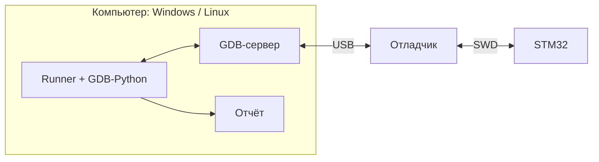
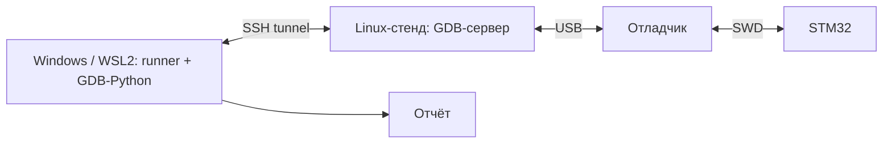
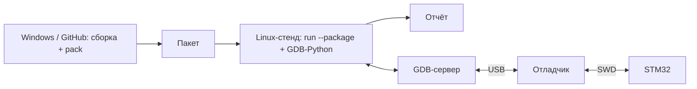
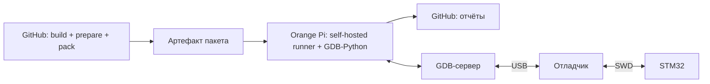
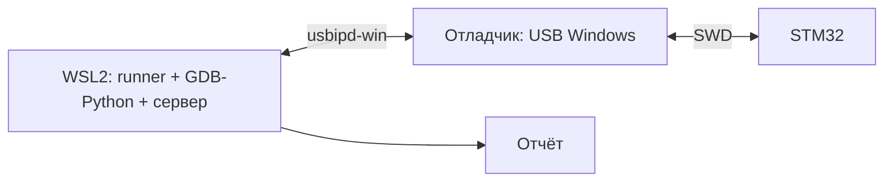

# Схемы запуска

[Документация](index.md) → Схемы запуска · [English](../en/RUN_LAYOUTS.md)

Сценарий и отчёт одинаковы во всех схемах; меняется только файл локального стенда
(`*.local.toml`, `remote.toml`), который остаётся у пользователя.

| Схема | Где выполняются runner/GDB | Соединение |
| --- | --- | --- |
| Локальная | Windows или Linux | Локальный GDB-сервер и USB/SWD |
| Удалённый сервер | Windows/Linux, в том числе WSL2 | SSH к хосту стенда |
| Пакет | На хосте исполнения | Подготовленные входы, локальный или SSH-сервер |
| Hardware CI | Self-hosted хост стенда | Отдельная от сборки аппаратная задача |
| Эмулятор | Windows/Linux | Собственный Renode или QEMU, без платы |

Проверенный объём каждого маршрута — [матрица 0.5.0](../development/release-050-acceptance.md).
Наличие схемы не означает аппаратную приёмку любого ОС/backend/MCU.
[Renode](../guides/ru/RENODE.md), [QEMU](../guides/ru/QEMU.md).

### Локальный запуск: Windows или Linux

Runner, GDB-Python и сервер работают на одном компьютере. Это схема Windows
и Orange Pi; локальный Linux x86_64 пока не проверен на оборудовании.

### Удалённый сервер: Windows или WSL2 → Linux-стенд

Runner и сценарий работают на рабочем ПК; SSH запускает сервер на стенде
и передаёт соединение GDB через туннель. Отладчик физически подключён к стенду.

### Пакет: сборка отдельно от запуска

На компьютер стенда передаётся пакет с ELF, профилем и сценариями.
`run --package` запускает там и GDB-Python, и сервер; отчёты сохраняются там же.

### Аппаратный CI: GitHub и self-hosted раннер

GitHub-hosted job собирает и проверяет пакет без платы. Self-hosted job
на Orange Pi скачивает пакет, запускает аппаратную проверку и загружает отчёты.

### WSL2 с USB-пробросом: аппаратно не проверено

Все процессы тестирования работают в WSL2; Windows передаёт USB-устройство
в Linux через usbipd-win. Это отдельный, пока не проверенный на платах вариант.

Удалённый режим работает только по ключам SSH; блокировка отладчика действует на
хосте стенда, связь контролируется сигналом присутствия. ST-LINK GDB Server на
Linux aarch64 недоступен (ST не выпускает его для arm64), поэтому на Orange Pi
используются OpenOCD, J-Link и st-util. Подробности: [Linux-стенд](../guides/ru/LINUX_STAND.md),
[GDB-серверы](../guides/ru/BACKENDS.md).

[Как читать метрики](HARDWARE_METRICS.md).
